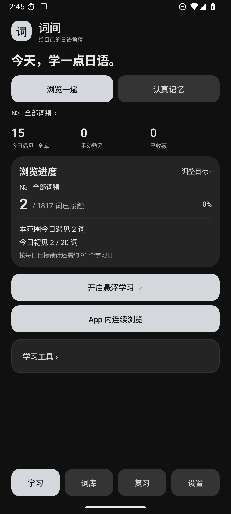
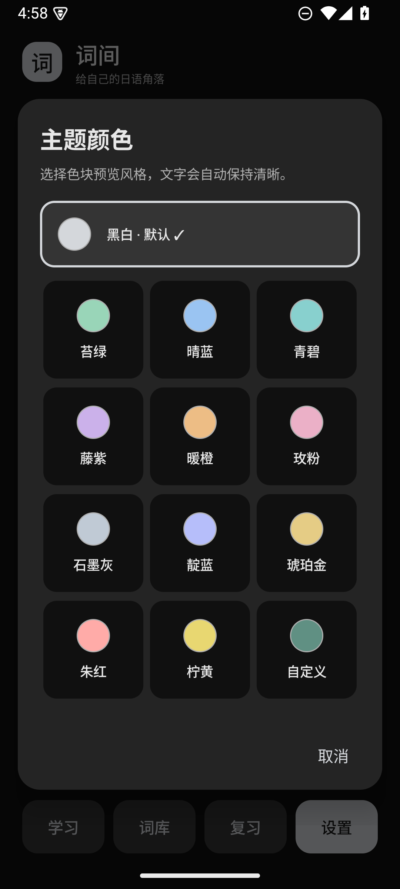

# 词间 · Cijian

[简体中文](README.md) | **English** | [日本語](README.ja.md)

A lightweight Android app for learning Japanese through Chinese meanings, either inside the app or in a floating window over other apps.

**Current release: 1.10.0 / build 15 · Android 8.0+ · Native Java UI · Actively maintained**

Developed with assistance from **GPT-6.1 Sol**, with **25+ hours of effort over roughly two weeks (author estimates)**. The project author maintains the requirements, usage feedback and ongoing iteration. The earliest verifiable release is dated **2026-10-27**; **1.10.0 is dated 2026-11-05**. [Development record, Chinese](docs/开发记录.md)

**Important language scope:** menus and help support Simplified Chinese, English and Japanese. Dictionary meanings and example translations remain Chinese. Selecting English or Japanese does not translate the dictionary.

Currently Android only; the iOS port remains deferred.

## Download

**[Download the latest APK](https://github.com/Myles-Li/Cijian/releases/latest)** · [Full version history, in Chinese](CHANGELOG.md)

The latest release is 1.10.0; 1.9.5 remains available as a historical release. Before upgrading, export a backup and install the same-signature official APK over the existing app to retain local records.

## Features

| Study rhythm | Inside the app | Floating window |
|---|---|---|
| Browse through | Continuous browsing, a daily first-exposure goal and range progress | Automatic rotation, manual navigation, a small ball and optional screen-off listening |
| Active recall | Daily tasks, due items first, recall before revealing and rating | The same durable batch, revealed state, ratings and interrupted-task continuation |

- 10,641 vocabulary cards from egg rolls, retaining Japanese, Chinese meanings, parts of speech, original pitch marks, simplified/traditional meanings and the first example.
- JLPT level and source frequency filters, shuffled cycles, favourites, manual familiarity, fixed-size groups and custom selections.
- Active recall, free practice, easily forgotten words and separate four-choice recognition practice, with explicit boundaries for which records each mode updates.
- Japanese/Chinese word and example speech, configurable repetitions, rate and pauses, through an Android TTS engine installed by the user.
- Local records and JSON backups that can be shared or saved; restore preview, conflict handling and undo of the most recent import.
- Light, dark and system themes; preset and custom colours; three UI languages; tutorials and a kana chart.

Dictionary access, study and records work locally. The app has no INTERNET permission, account system or ads. An external TTS engine may use online voices under its own network behaviour. The current app does not provide English dictionary meanings, a grammar course or user-dictionary import.

## Screens and structure

 

[Offline interactive structure map](docs/词间-完整结构图.html) · [Architecture and statistics](docs/结构审阅.md) · [How review works](docs/复习怎样运作.md)

Detailed guides and the map are currently in Chinese. Download the HTML and open it in a browser for offline expansion, search, rule demonstrations and feedback drafts. Drafts stay in the local browser; exporting a file does not automatically send it.

## Version milestones

| Version | Main changes |
|---|---|
| 1.10.0 | Independent in-app study text sizes, swipe navigation, header position lock, compact example action and adjustable detail height |
| 1.9.5 | Detail drag/scroll handling, settings organisation and spacing, default-colour grid, equal study entry points, smoother mode changes and refresh recovery across key changes |
| 1.9.0 | Cijian English display name, first-run language selection, default monochrome theme, custom batch size 1–50 and detailed review help |
| 1.8.0 | Three UI languages, layered study/review navigation, sequential undo, rapid-operation and notification fixes |
| 1.7.5 | Both study rhythms on both surfaces, shared batches and queues, four-choice recognition practice |
| 1.7 | Per-range positions, durable review continuation, quiet boot recovery, position lock and restore undo |
| 1.6 | Independent speech on manual navigation, search normalisation, three text sizes, forgotten-word practice, themed selectors and tutorials |
| 1.5.5 | Japanese/English experiment followed by a complete Chinese-learning edition; long-word and narrow-window large-text fixes |
| 1.5.0 | Consistent statistics snapshots, browsing progress, ten-item due review and validated restore preview |
| 1.4.0 | Shareable backups, two study rhythms, a review tab, mark undo and speech sequencing |
| 1.3.0 | Daily first-exposure goals, backup v2, simple recall scheduling and custom theme colours |
| 1.2.0 | Groups and custom selections, study sources, settings categories and kana help |
| 1.1.0 | Improved dragging, frequency filters, shuffled cycles, example speech, background listening and theme modes |
| 1.0.0 | Initial floating card, dictionary search, basic marks, TTS and JSON record backup |

The [full changelog](CHANGELOG.md) also distinguishes the two historical 1.5.5 editions. These notes describe earlier behaviour; the current app does not include the old English-learning data.

## Read and build the source

The [source-reading guide, in Chinese](docs/源码阅读指南.md) starts with opening the root folder in VS Code. Suggested entry points: ReviewPlan.java, then MainActivity.java, FloatService.java and ReviewFlow.java. Android Studio is recommended for running and debugging.

Build requirements: JDK 17, Android SDK 35, Build Tools 35.0.0 and Gradle 8.11.1. Initial setup downloads build tools and dependencies.

```text
Windows:       gradlew.bat :app:assembleDebug
macOS / Linux: sh ./gradlew :app:assembleDebug
Logic checks:  python tools/test_logic.py
```

The public project uses a normal local debug signature and contains no private release-signing configuration. A locally built APK has a different signature from the official APK; use a dedicated emulator for development. [Build and test scope, Chinese](docs/验证与测试.md) · [Final 1.10.0 validation record, Chinese](docs/VALIDATION.md)

The original pinned TSV, provenance and conversion script are included. `python tools/prepare_deck.py` rebuilds the repository vocabulary asset; it rebuilds its word table and does not operate on phone learning records.

## Name, code rights and data sources

The product name is **词间 · Cijian**. Legacy Kotoba identifiers in the package, database and backup paths preserve upgrade and record compatibility. The existing official APK still saves backups under Download/Kotoba. See [naming and compatibility, Chinese](docs/命名与兼容.md).

**Application code is publicly viewable, with no open-source licence or additional code-reuse permission granted at present.** Viewing and forking on GitHub follow GitHub's terms; contact the author for other code-use, modification or distribution permissions. See [code rights, Chinese](COPYRIGHT.md). This does not prevent personal noncommercial Japanese study with the official APK.

Dictionary author: **egg rolls / 5mdld**, from [anki-jlpt-decks](https://github.com/5mdld/anki-jlpt-decks), independently under **CC BY-NC 4.0**. Retain attribution, observe the noncommercial restriction and keep the original licence. Gradle Wrapper is independently under Apache License 2.0. [Third-party notices and conversion details](THIRD_PARTY_NOTICES.md) · [Original dictionary licence](data/upstream/LICENSE)

The repository contains the complete current app, build files, native tests, logic tests, conversion data and public documentation. Private signing material, machine caches, private feedback, older APKs and personal learning records remain local. Issues and suggestions are welcome; development is ongoing.
