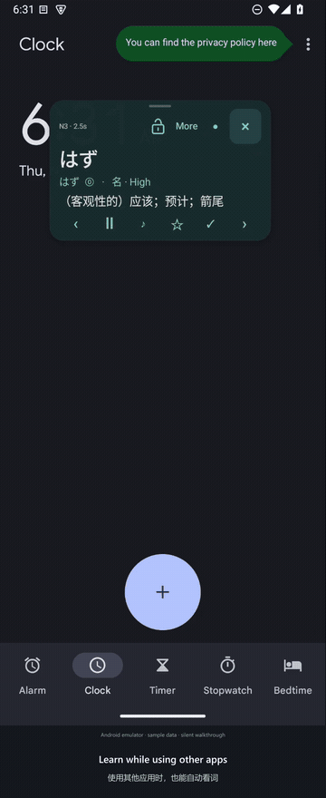
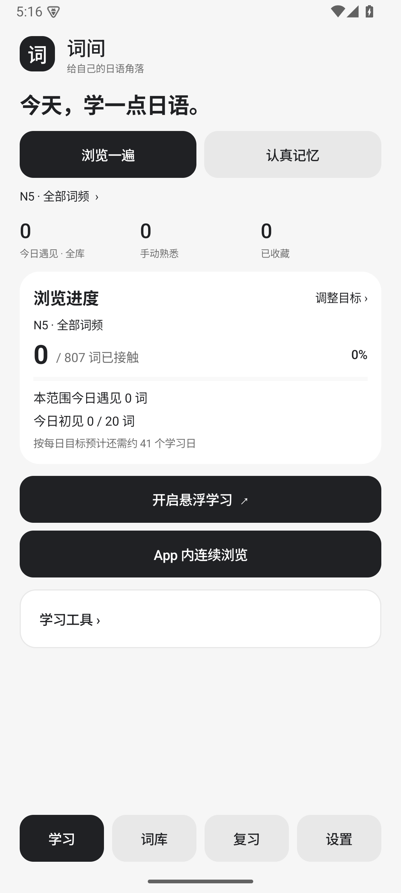
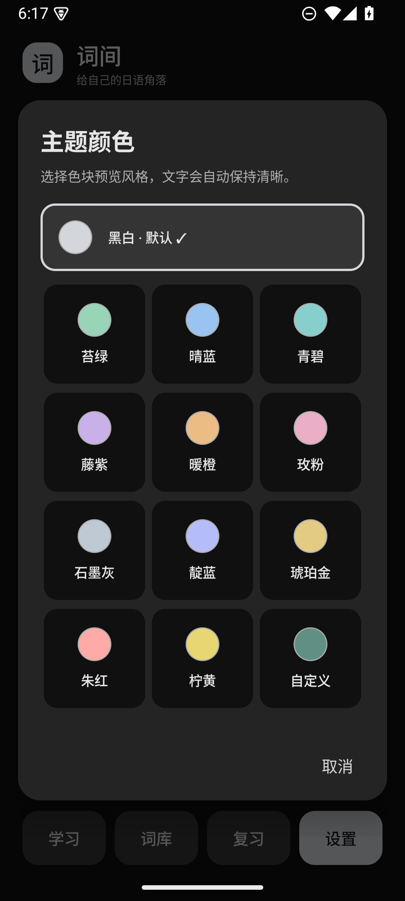

# 词间 · Cijian

[简体中文](README.md) | [English](README.en.md) | **日本語**

中国語の語義で日本語を学ぶ、軽量なAndroidアプリです。アプリ内で集中して学習するほか、他のアプリに重ねたフローティングウィンドウですき間時間に単語を繰り返し確認できます。

**現在の版：1.10.0 / ビルド15 · Android 8.0以降 · JavaによるネイティブUI · 継続更新中**

**GPT-6.1 Sol** の支援で開発し、累計 **25時間以上、開発期間は約2週間（作者の概算）** です。要件、利用時のフィードバック、継続的な改善は作者が管理しています。確認できる最初の版は **2026-10-27**、**1.10.0の更新日は2026-11-05** です。継続して更新しています。[開発記録と時間の扱い（中国語）](docs/开发记录.md)

**言語について：** メニューと説明の表示言語は簡体字中国語・英語・日本語から選べます。単語の語義と例文の訳は中国語のままです。表示言語を切り替えても、辞書の内容は翻訳されません。

## 1分以内で見る詞間

[](https://github.com/Myles-Li/Cijian/releases/download/v1.10.0/cijian-demo-1.10.0.mp4)

[実演動画を見る／保存する（MP4、1分以内）](https://github.com/Myles-Li/Cijian/releases/download/v1.10.0/cijian-demo-1.10.0.mp4)。他のアプリ上での学習、移動と位置固定、小さなボール、例文とお気に入り、アプリ内閲覧と想起を紹介します。実際のAndroidアプリをエミュレーター上で録画し、サンプル学習データを使用しています。音声なし・英中字幕付きです。

iPhoneからも動画を確認できます。今回はAndroid版を公開し、iOS版は保留しています。

## ダウンロード

**[最新APKをダウンロード](https://github.com/Myles-Li/Cijian/releases/latest)** · [全バージョンの更新履歴（中国語）](CHANGELOG.md)

最新版は1.10.0で、1.9.5は過去のリリースとして残しています。更新前にバックアップを保存し、同じ署名の公式APKを既存アプリへ上書きインストールしてください。既存の学習記録を残したまま更新できます。

## 主な機能

| 学習の進め方 | アプリ内 | フローティングウィンドウ |
|---|---|---|
| 一通り見る | 連続閲覧、その日に初めて触れる単語の目標、選択範囲の進捗 | 自動切り替え、手動移動、小さなボールへの折りたたみ、任意の画面消灯中の音声学習 |
| 思い出して覚える | 毎日の課題、復習期限の来た単語を優先、答えを開く前に思い出して自己評価 | 同じ保存済み課題、答えの表示状態、評価、中断位置を引き継ぐ |

- egg rollsの10,641件を内蔵。日本語、中国語の語義、品詞、元のアクセント番号、簡体字／繁体字の語義、最初の例文を保持します。
- JLPTレベルと元データの頻度区分による絞り込み、一巡するランダム順、お気に入り、手動の習熟マーク、固定語数のグループ、自選グループ。
- 能動的な想起、自由練習、忘れやすい単語、独立した四択練習。それぞれがどの記録を更新するかを説明しています。
- 日本語・中国語の単語と例文の読み上げ。回数、速度、間隔を設定でき、利用者がインストールしたAndroid TTSエンジンを使用します。
- ローカルの学習記録と、共有または保存できるJSONバックアップ。復元前の確認、競合の扱い、直前のインポートの取り消し。
- ライト／ダーク／システム連動、既定色と色コード指定、3言語のUI、使い方と五十音の説明。

辞書、学習、記録は端末内で動作します。アプリにINTERNET権限、アカウント機能、広告はありません。外部TTSエンジンのオンライン音声は、そのエンジンの通信方針に従います。現在、英語の語義を使う学習機能、文法講座、利用者の辞書インポートは提供していません。

## 画面と構造

 

[オフラインの対話型構造図](docs/词间-完整结构图.html) · [構造と統計の定義](docs/结构审阅.md) · [復習の仕組み](docs/复习怎样运作.md)

詳細な説明と構造図は現在中国語です。HTMLをダウンロードしてブラウザーで開くと、オフラインで展開、検索、動作ルールの確認、改善メモの作成ができます。メモはそのブラウザーに保存され、ファイルを書き出しても自動送信されません。

## バージョンごとの主な変更

| 版 | 主な内容 |
|---|---|
| 1.10.0 | アプリ内学習文字サイズ、左右スワイプ、上部の位置ロック、簡潔な例文操作、詳細の高さ調整、短い実演動画 |
| 1.9.5 | 詳細画面の移動とスクロール、設定分類と余白、既定色の並び、2つの学習入口、モード切り替えと日付などの条件変更時の更新処理を改善 |
| 1.9.0 | 英語表示名Cijian、初回の言語選択、既定の白黒テーマ、1～50語の自由なバッチ設定、詳しい復習説明 |
| 1.8.0 | 3言語のUI、学習／復習の入口整理、連続操作の取り消し、高速操作と通知の修正 |
| 1.7.5 | 2つの学習方法を両画面で利用、課題と順序の共有、四択練習 |
| 1.7 | 範囲ごとの位置、中断した復習の再開、無音での起動復元、位置固定、復元の取り消し |
| 1.6 | 手動移動時の独立した読み上げ、検索の正規化、3種類の文字サイズ、忘れやすい単語、テーマに沿う選択画面と使い方 |
| 1.5.5 | 日英学習の試験版を経て完全な中国語学習版へ。長い単語と狭いウィンドウの大きな文字を修正 |
| 1.5.0 | 統計を同じ時点で取得、閲覧進捗、期限到来語10件の小課題、復元前の検証 |
| 1.4.0 | バックアップ共有、2つの学習方法、復習タブ、マークの取り消し、読み上げの連携 |
| 1.3.0 | 初めて触れる語の1日目標、バックアップv2、簡単な想起予定、自由なテーマ色 |
| 1.2.0 | グループ、自選語、学習対象、設定分類、五十音 |
| 1.1.0 | 移動操作、頻度、一巡するランダム順、例文読み上げ、バックグラウンド音声、テーマモード |
| 1.0.0 | 最初の単語ウィンドウ、辞書検索、基本マーク、TTS、JSON記録バックアップ |

[全更新履歴](CHANGELOG.md)では、過去の1.5.5の2つの版も区別しています。過去の説明は当時の動作を示すもので、現在のアプリに旧英語学習データは含まれません。

## ソースを読む・ビルドする

[ソース読解ガイド（中国語）](docs/源码阅读指南.md)では、VS Codeでルートフォルダーを開くところから説明しています。まずReviewPlan.java、次にMainActivity.java、FloatService.java、ReviewFlow.javaを読む順序を勧めています。実行・デバッグにはAndroid Studioが便利です。

ビルド環境はJDK17、Android SDK35、Build Tools35.0.0、Gradle8.11.1です。初回はツールと依存関係のダウンロードに通信が必要です。

```text
Windows:       gradlew.bat :app:assembleDebug
macOS / Linux: sh ./gradlew :app:assembleDebug
Logic checks:  python tools/test_logic.py
```

公開ソースには配布用の秘密署名設定がなく、通常のローカルdebug署名を使います。自分でビルドしたAPKは公式版と署名が異なるため、開発には専用エミュレーターを使用してください。[ビルドと検証範囲（中国語）](docs/验证与测试.md) · [1.10.0の最終検証記録（中国語）](docs/VALIDATION.md)

固定版の元TSV、出典、変換スクリプトも含みます。`python tools/prepare_deck.py`はリポジトリ内の辞書資産を作り直します。単語テーブルを再構築する処理であり、電話内の学習記録を操作するものではありません。

## 名称・コードの利用条件・データ出典

現在の製品名は **词间 · Cijian** です。パッケージ、データベース、バックアップ内のKotobaという旧識別子は、上書き更新と記録の互換性のために残しています。現行の公式APKの保存先はDownload/Kotobaです。[名称と互換性（中国語）](docs/命名与兼容.md)

**アプリのコードは公開展示中で、現時点ではオープンソースライセンスや追加のコード再利用許諾を付与していません。** GitHub上の閲覧・forkは同サービスの利用規約に従います。それ以外のコード利用・改変・再配布の許諾は作者へお問い合わせください。[コードの利用条件（中国語）](COPYRIGHT.md)。公式APKを個人の非商業的な日本語学習に使うことを妨げるものではありません。

単語データの作者は **egg rolls / 5mdld**、出典は[anki-jlpt-decks](https://github.com/5mdld/anki-jlpt-decks)で、独立して **CC BY-NC 4.0** に従います。クレジット、非商業条件、元のライセンスを保持してください。Gradle Wrapperには独立してApache License2.0が適用されます。[第三者の内容と変換について](THIRD_PARTY_NOTICES.md) · [元辞書のライセンス](data/upstream/LICENSE)

このリポジトリには現在のアプリ全体、ビルド設定、ネイティブテスト、ロジックテスト、辞書変換データ、公開文書を含みます。個人の署名、端末固有キャッシュ、非公開の要望・写真、旧APK、個人の学習記録はローカルに残します。問題や提案はIssueへお寄せください。アプリは継続更新中です。
