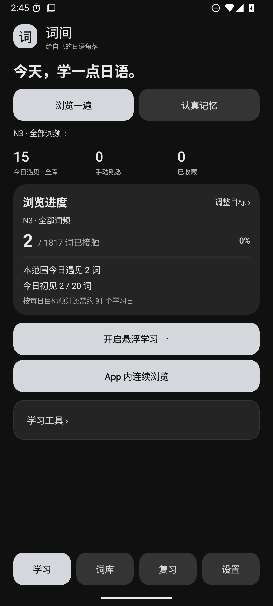
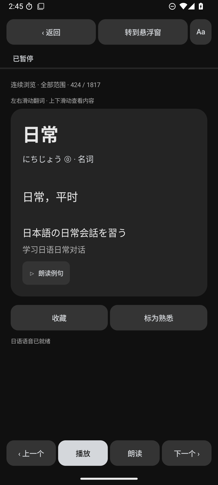
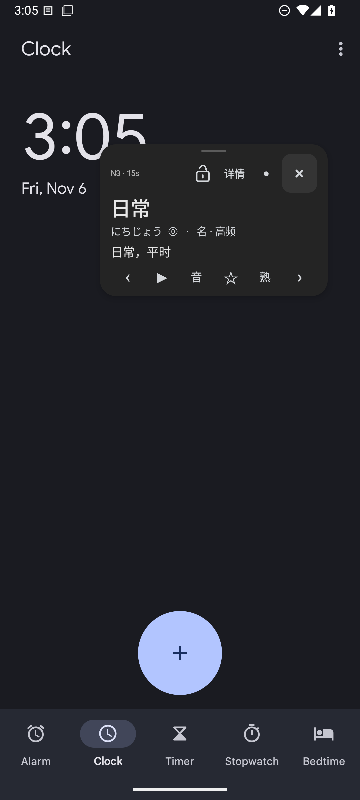
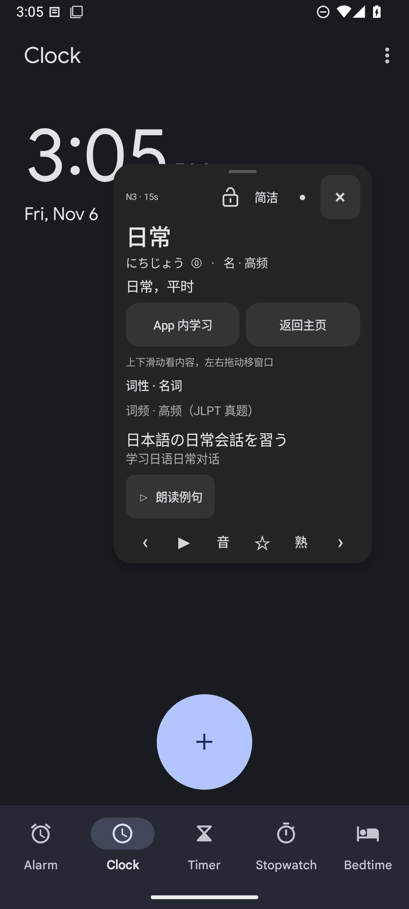
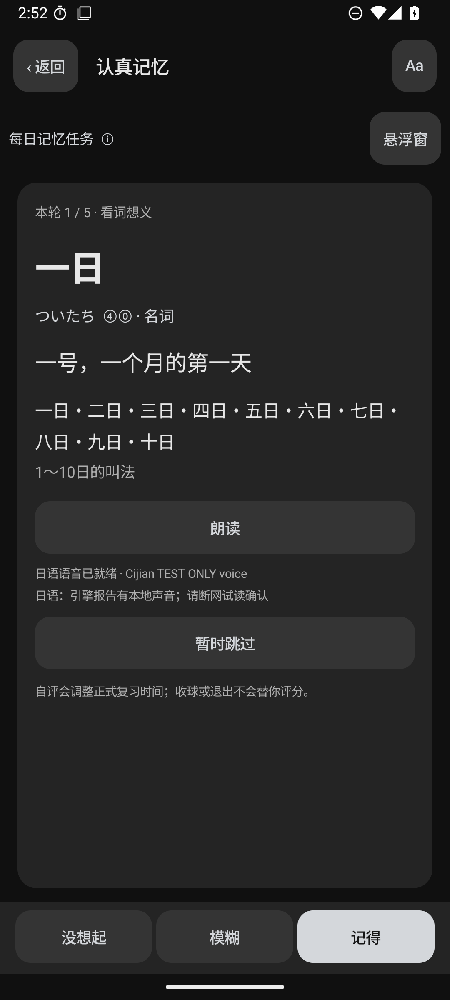
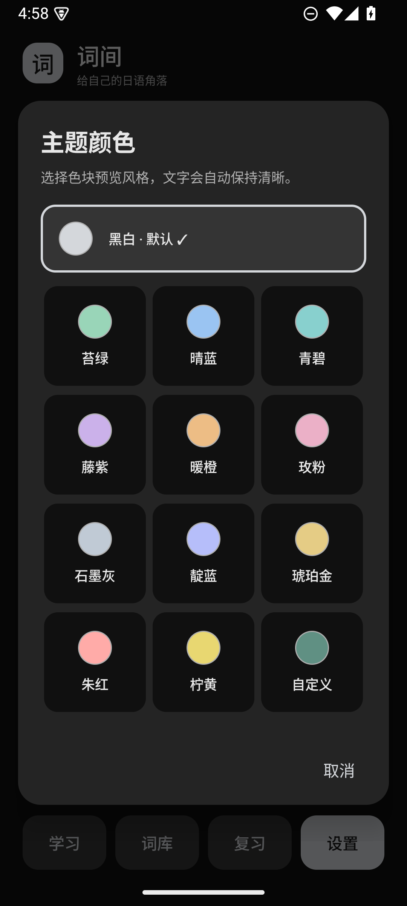

# 词间 · Cijian

**简体中文** | [English](README.en.md) | [日本語](README.ja.md)

一个轻量的安卓日语学习应用：既能在 App 内专注学习，也能用悬浮窗利用碎片时间反复遇见单词。

**当前版本：1.10.5 / 构建17 · Android 8.0+ · Java 原生界面 · 持续更新中**

在 **GPT-6.1 Sol** 辅助下开发，累计开发投入 **25 小时+，开发跨度约两周（作者估算）**。需求、使用反馈和持续迭代由项目作者维护。[开发记录与时间口径](docs/开发记录.md)

项目首个可核验版本形成于 **2026-10-27**；**1.10.5 更新于 2026-11-07**，持续更新中。

Native Android app for learning Japanese through Chinese meanings. The interface supports 简体中文 / English / 日本語. Interface language changes do not translate the dictionary.

当前正式发布仍仅安卓；本实验分支另有[iOS可行性验证工程](ios-proof/README.md)，不是完整移植。画中画显示与真实iPad安装尚待验证。

## 下载

**[下载最新 APK](https://github.com/Myles-Li/Cijian/releases/latest)** · [全部版本更新说明](CHANGELOG.md)

**已使用1.10.1：直接用官方1.10.5覆盖安装，不先卸载，保留记录与未完成批次。** 仍使用1.10.0或更早版本的用户需先导出JSON，在Cijian中恢复核对；确认前不要卸载旧版。[升级与迁移步骤](docs/从旧版迁移.md)。历史Release保留。

## 主要功能

| 学习节奏 | App 内 | 悬浮窗 |
|---|---|---|
| 浏览一遍 | 连续浏览、每日初见目标与范围进度 | 自动轮换、手动翻词、小球及可选锁屏继续听 |
| 认真记忆 | 每日任务、到期优先、先回忆再揭晓评分 | 共用正式批次、揭晓状态、评分和中断续接 |

- 内置 egg rolls 的10,641词，保留原日语、中文释义、词性、音型、简繁释义与首条例句。
- 等级与词频筛选、整轮随机、收藏／熟悉、固定组和自选组。
- 主动回忆、自由练习、易忘词和独立四选一；各自写入记录的边界有明确说明。
- 日中单词／例句连读，次数、语速和停顿可调；使用用户安装的Android TTS引擎。
- 本地记录，JSON备份可分享或保存；恢复预览、冲突规则和最近一次导入撤回。
- 浅色／深色／跟随系统、预设主题色及自定义色号、三语界面、教程与五十音说明。

词库、学习和记录离线运行；应用没有INTERNET权限，无账号和广告。外置TTS引擎可能使用在线声音，其网络行为由对应引擎决定。当前没有英语释义学习模块、语法课程或用户词库导入。

## 界面与结构

以下全部为1.10.5最终安装包在专用安卓模拟器中的真实界面，使用演示数据。悬浮学习图覆盖安卓时钟应用；复习图中的TEST ONLY voice是模拟器测试引擎，不随正式APK提供。

 

 

 

[离线互动完整结构图](docs/词间-完整结构图.html) · [结构与统计口径](docs/结构审阅.md) · [复习怎样运作](docs/复习怎样运作.md)

结构图下载后用浏览器离线打开，支持展开、搜索、规则演示和反馈草稿。网页反馈保存在本地浏览器，导出文件后可自行提交到仓库，不自动发送。

## 版本里程碑

| 版本 | 主要变化 |
|---|---|
| 1.10.5 | 整页横滑翻词、并排按钮留白、简短语音状态与设置往返、说明行距及新版展示截图 |
| 1.10.1 | 完整更换为Cijian安装标识、源码与新备份命名；旧JSON仍可导入，新旧应用独立并存 |
| 1.10.0 | App内独立学习字号、词卡左右滑动、顶部位置锁、紧凑例句操作、详情高度调节 |
| 1.9.5 | 详情拖动与滚动、设置分类与间距、默认色网格、双学习入口、切换与跨日刷新修复 |
| 1.9.0 | Cijian英文显示名、首启三语选择、默认黑白、自定义每批1～50及完整复习说明 |
| 1.8.0 | 三语界面、学习／复习分层、连续撤销、快速操作与通知清理修复 |
| 1.7.5 | 浏览／记忆均支持App与悬浮、共用批次与队列、四选一识义 |
| 1.7 | 按范围记位置、复习断点续接、安静开机恢复、位置锁定、恢复撤回 |
| 1.6 | 手动翻词独立朗读、搜索归一、三类字号、易忘词、主题选项面板和教程 |
| 1.5.5 | 日英学习实验后保留完整中文学习；修复长词与大字窄窗显示 |
| 1.5.0 | 统一统计快照、浏览进度、十词到期小批及备份预览校验 |
| 1.4.0 | 分享备份、两种学习风格、独立复习页、标记撤销和语音衔接 |
| 1.3.0 | 每日初见目标、备份v2、简单回忆安排和自定义主题色 |
| 1.2.0 | 分组、自选组、学习来源、设置分类、五十音图 |
| 1.1.0 | 拖动改善、词频、随机整轮、例句连读、后台听词与主题模式 |
| 1.0.0 | 首版悬浮卡片、词库搜索、基础标记、TTS及JSON记录备份 |

详细变化和早期中英实验说明见 [CHANGELOG.md](CHANGELOG.md)。

## 阅读与构建源码

[源码阅读指南](docs/源码阅读指南.md)从VS Code打开根文件夹讲起；建议先读ReviewPlan.java，再看MainActivity.java、FloatService.java与ReviewFlow.java。运行和调试推荐Android Studio。

构建环境：JDK17、Android SDK35、Build Tools35.0.0、Gradle8.11.1。

```text
Windows:       gradlew.bat :app:assembleDebug
macOS / Linux: sh ./gradlew :app:assembleDebug
Logic checks:  python tools/test_logic.py
```

源码采用普通debug开发签名，不含作者发布签名；自行构建的包与官方APK签名不同，建议使用专用模拟器开发。[验证与测试](docs/验证与测试.md) · [1.10.5最终验证记录](docs/VALIDATION.md)

原词库TSV、来源和转换工具随项目保留，可用 `python tools/prepare_deck.py` 重建仓库词库资产。该操作针对项目文件，不操作手机记录；转换会重建词条表。

## 名称、许可与数据来源

当前统一名称为 **词间 · Cijian**。1.10.1源码包、目录与安装标识均为 `com.myles.cijian`，数据库和新备份名称使用Cijian；旧JSON备份v1/v2仍可导入。1.10.5沿用此标识，可覆盖1.10.1；从1.10.0及更早安装标识迁移才需手动导入记录，详见[名称与迁移标识](docs/命名与兼容.md)。

**应用代码暂不授予开源许可，仅公开展示。** 查看和fork遵循GitHub服务条款；其他代码使用、修改或分发授权请联系作者。见 [代码许可状态](COPYRIGHT.md)。

词库作者为 **egg rolls / 5mdld**，来源 [anki-jlpt-decks](https://github.com/5mdld/anki-jlpt-decks)，独立遵守 **CC BY-NC 4.0**，保留署名、非商业限制及完整许可。Gradle Wrapper独立遵守Apache2.0。[第三方内容与转换说明](THIRD_PARTY_NOTICES.md) · [原词库许可](data/upstream/LICENSE)

源码仓库包含完整应用、构建文件、原生测试、逻辑测试、词库转换数据与公开文档。个人签名、本机缓存、私人需求、反馈照片、历史APK和个人学习记录留在本地。问题或建议可提交Issue；应用仍在持续更新。
